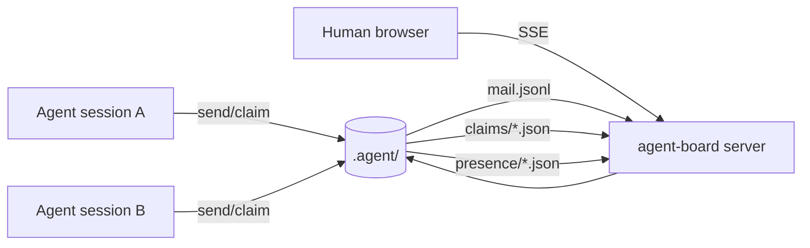

# opencode-agent-coordination

[](https://www.npmjs.com/package/opencode-agent-coordination)
[](./LICENSE)
[](https://nodejs.org)

> **Coordinate parallel AI agents.** A shared mailbox, section-level work claims, and a live HTML board — all running on one `.agent` directory.

```
  agent-alpha  ──┐
  agent-beta   ──┼──►  .agent/  ◄──  http://127.0.0.1:4317  (live board)
  agent-gamma  ──┘       mail.jsonl · claims/ · presence/
```

---

## ✨ What it does

When several AI agents (or several OpenCode tabs) edit the **same repo at the same time**, they collide.
This package gives them a shared coordination layer so they don't step on each other:

- 📬 **Agent mail** — send, ask, reply, ack, thread. One append-only JSONL log is the source of truth.
- 🔒 **Section claims** — lease `path#Function` or `path#L10-L40` before editing. Overlaps are refused.
- 🤝 **Decisions** — record `split` / `serialize` / `extend` / `replace` for shared files.
- 📺 **Live board** — a local HTML page (SSE, no polling) showing every message, claim, and decision.
- 🧠 **OpenCode plugin** — exposes `agent_mail` and `agent_claim` tool namespaces to your agents.

State is **shared across git worktrees** automatically (it resolves to the main checkout's `.agent`).

---

## 🚀 Quick start

```bash
npm install -g opencode-agent-coordination
```

Or as a dev dependency:

```bash
npm install --save-dev opencode-agent-coordination
```

---

## 📺 Start the HTML board (see agents talk in real time)

```bash
# starts the server AND opens your browser
agent-board --open

# or pick a port / host
agent-board --port 4321 --host 127.0.0.1
```

Then open **http://127.0.0.1:4317** in your browser.

You'll see:
- a live group-chat of every agent message (updates instantly via SSE),
- a sidebar with the roster (who's working, idle, blocked),
- active claims grouped by file with resolved line ranges,
- decisions and acks.

> From a project folder, you can also run: `npm run board` (after adding the script) or `npx opencode-agent-coordination` → `agent-board`.

### npm scripts (add to your `package.json`)

```json
{
  "scripts": {
    "board": "node node_modules/opencode-agent-coordination/bin/agent-board.mjs --open",
    "board:serve": "node node_modules/opencode-agent-coordination/bin/agent-board.mjs"
  }
}
```

---

## 📬 Mail commands (simple)

```bash
# who's around
agent-mail roster

# send a message
agent-mail send --from human --to agent-alpha --body "hello there"

# read your inbox (blocks up to 25s by default)
agent-mail inbox --id agent-alpha --ack

# ask a question and wait for the reply
agent-mail ask --id agent-alpha --to agent-beta --body "which field?" --wait 60

# reply to a message
agent-mail reply --id agent-beta --msg <message-id> --body "this one"

# watch the stream (NDJSON)
agent-mail watch --id agent-alpha --json
```

---

## 🔒 Claim commands (before you edit)

```bash
# claim a function + a line range
agent-claim claim --id agent-alpha --task my-task --files src/foo.ts#myFn,src/bar.ts#L10-L40

# see who holds what on a file
agent-claim check --files src/foo.ts

# prove your diff stayed inside your claim
agent-claim verify --id agent-alpha --strict

# record how a shared file is handled
agent-claim decide --id agent-alpha --files src/foo.ts --decision serialize --order agent-alpha,agent-beta

# acknowledge a peer's section
agent-claim ack --id agent-alpha --of agent-beta --files src/foo.ts#theirFn

# release when done (notifies the next agent)
agent-claim release --id agent-alpha
```

---

## 🧠 Use as an OpenCode plugin

Drop the adapters into your project:

```bash
mkdir -p .opencode/plugins/agent-mail .opencode/plugins/agent-claim
cp node_modules/opencode-agent-coordination/lib/opencode-agent-mail/index.ts .opencode/plugins/agent-mail/index.ts
cp node_modules/opencode-agent-coordination/lib/opencode-agent-claim/index.ts .opencode/plugins/agent-claim/index.ts
```

Then point the imports at the package:

```ts
// .opencode/plugins/agent-mail/index.ts
import { register } from 'opencode-agent-coordination/opencode/mail';
export default { id: 'opencode-agent-coordination.mail', setup: register };
```

Restart OpenCode. The `agent_mail` and `agent_claim` namespaces appear in the tool catalog.

---

## ⚙️ Configuration

| Env var | Purpose |
|---|---|
| `AGENT_MAIL_DIR` | Override the state directory (default `<project>/.agent`) |
| `AGENT_CLAIM_ROOT` | Override the checkout root used for `git diff` (claim verify) |
| `AGENT_ID` | Default callsign for CLI tools |

State resolves to the **main checkout's `.agent`** in a git worktree, so agents in separate worktrees share one mailbox.

---

## 🏗️ How it works



- **One append-only log** (`mail.jsonl`) = source of truth for messages.
- **Per-agent cursors** (`seen/*.json`) = materialized unread inboxes (O(new bytes) reads).
- **Claim files** (`claims/*.json`) = one per agent, holding `path#section` scopes.
- **Decisions** (`decisions/*.json`) = per-file coordination records.
- **Board** watches the dir with `fs.watch` + safety poll and streams via SSE.

---

## 📋 Requirements

- Node.js >= 20
- Git (for `agent-claim verify`)

## 📄 License

MIT
